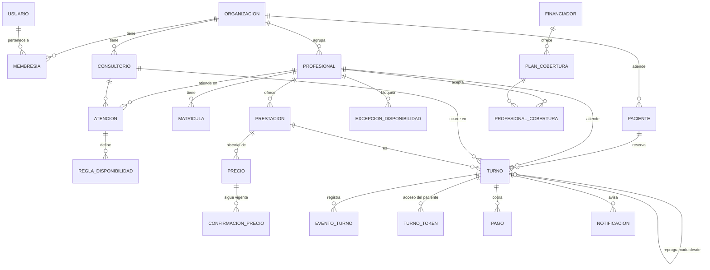
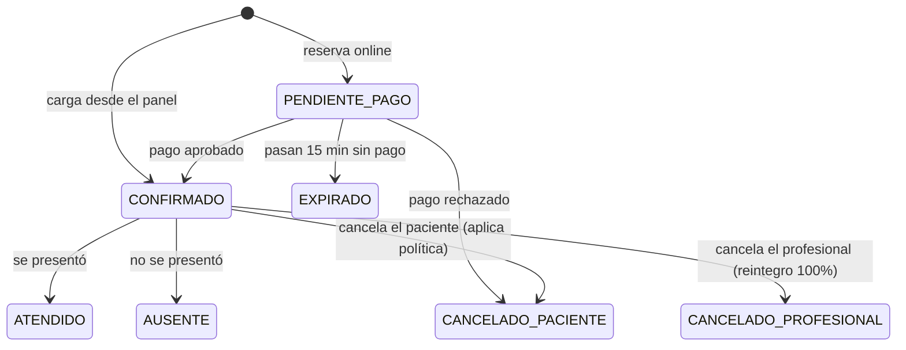

# Diseño de backend y base de datos

> Actualizado: 2026-11-21 · Estado: **propuesto**. Es el destino al que va el prototipo, no una foto de lo que hay hoy (ver [Del prototipo a producción](#del-prototipo-a-producción)).
> Detalle completo: [docs/02-arquitectura.md](../docs/02-arquitectura.md) y [docs/03-modelo-de-datos.md](../docs/03-modelo-de-datos.md). Este documento junta las dos cosas en una sola vista y explica las decisiones.

## Principios

Bajan de los [lineamientos](lineamientos.md#principios-de-ingeniería) y guían cualquier cambio en el backend:

1. **Las garantías viven en la base.** Lo que no puede pasar nunca (dos turnos superpuestos, un pago procesado dos veces) lo impide una restricción de Postgres, no el código.
2. **Estados explícitos y auditados.** El turno cambia solo a través de su máquina de estados y cada cambio deja un evento.
3. **Lo externo es idempotente.** Webhooks y tareas programadas pueden llegar dos veces o tarde; el resultado tiene que ser el mismo.
4. **No custodiamos fondos.** Mercado Pago le paga al profesional y separa nuestra comisión.
5. **Multi-organización desde el día 1.** Toda tabla de negocio pertenece a una organización.
6. **Mínimo dato.** Sin datos clínicos en Fases 0 y 1; lo sensible, cifrado.
7. **Hora de Argentina.** Se guarda en UTC (`timestamptz`) y se interpreta siempre en `America/Argentina/Buenos_Aires`.

## Vista general

```
                    ┌──────────────────────────── Vercel (región gru1, São Paulo) ───────────────────────────┐
 Paciente ─────────►│  Next.js (App Router)                                                                   │
 Profesional ──────►│   ├─ Server Components ── lectura                                                       │
 Secretaria ───────►│   ├─ Server Actions ───── mutaciones (validan input y rol)                              │
                    │   └─ Route handlers ───── webhooks: Mercado Pago, WhatsApp (estados de entrega)         │
                    │            │                                                                            │
                    │            ▼                                                                            │
                    │   modules/  identidad · profesionales · consultorios · catalogo · agenda ·              │
                    │             pacientes · pagos · notificaciones · busqueda                               │
                    └────────────┬───────────────────────────────┬────────────────────────────────────────────┘
                                 │                               │
                                 ▼                               ▼
                    Postgres + PostGIS (Neon/Supabase,     Inngest (tareas programadas y reintentos)
                    sa-east-1)                               ├─ expirar reservas sin pagar (cada minuto)
                     ├─ EXCLUDE anti doble reserva           ├─ recordatorios T-48 h / T-24 h
                     ├─ RLS por organización                 ├─ conciliar pagos (diario)
                     └─ auditoría append-only                └─ revisión de precios (semanal)

 Servicios externos: Mercado Pago (cobro + split) · WhatsApp Cloud API (avisos con link) · Resend (email + .ics)
                     · Web Push (panel) · Georef/USIG (direcciones) · REFEPS/SISA (matrículas) · MapTiler (mapa)
```

## Módulos y dueños de los datos

Cada módulo es dueño de sus tablas y expone una API en `src/modules/<x>/index.ts`. Ningún módulo lee las tablas de otro: le pide los datos a su API. Así cualquier módulo puede separarse más adelante sin reescribir el resto.

| Módulo | Responsabilidad | Tablas que posee |
|---|---|---|
| `identidad` | Usuarios, login, organizaciones, roles | `usuario` (Better Auth), `organizacion`, `membresia` |
| `profesionales` | Perfil, matrícula y su verificación | `profesional`, `matricula` |
| `consultorios` | Direcciones, geocoding, precisión pública del pin | `consultorio`, `atencion` |
| `catalogo` | Prestaciones, precios con vigencia, coberturas aceptadas | `prestacion`, `precio`, `confirmacion_precio`, `financiador`, `plan_cobertura`, `profesional_cobertura` |
| `agenda` | Disponibilidad, cálculo de huecos, turnos y su máquina de estados, políticas | `regla_disponibilidad`, `excepcion_disponibilidad`, `turno`, `evento_turno`, `turno_token` |
| `pacientes` | Datos de contacto y cobertura del paciente | `paciente` |
| `pagos` | Cobro, comisión, reintegros, conciliación | `pago`, `webhook_evento` |
| `notificaciones` | WhatsApp, email, push y su registro | `notificacion`, `suscripcion_push` |
| `busqueda` | Consultas geográficas y filtros del buscador | Ninguna: lee vistas o pide datos a los otros módulos |

Transversal a todos: `auditoria` (append-only) y las utilidades de `src/lib` (base, tiempo, plata, errores).

## Modelo de datos

### Entidades



### Decisiones del modelo

| Decisión | Por qué |
|---|---|
| **La organización es el tenant**, no el profesional | Un consultorio compartido, una clínica o un hospital entran sin rehacer el modelo |
| **El precio tiene historial** (`precio.vigente_desde`) y confirmaciones aparte | "Actualizado hace N días" sale del dato; confirmar sin cambiar el monto también cuenta como actualizar |
| **El turno guarda un snapshot** de precio, cargo y política al reservar | Si el profesional cambia el precio mañana, el turno de hoy no cambia |
| **El paciente pertenece a la organización** y se vincula a un usuario si reserva online | La secretaria carga "María, 11-…" sin que María tenga cuenta |
| **Confirmación de asistencia separada del estado** (`turno.confirmacion_paciente`) | El turno sigue reservado aunque el paciente no haya respondido; mezclarlos rompe las métricas |
| **Reprogramar = cancelar + turno nuevo** enlazado por `turno_origen_id` | La restricción anti doble reserva sigue protegiendo el nuevo horario |
| **El acceso del paciente es por token** (`turno_token`, guardado como hash, con vencimiento) | `/t/[token]` funciona sin login y nunca expone el id del turno |
| **Montos en centavos** (`bigint`), moneda explícita | Sin errores de redondeo |
| **Ubicación como `geography(Point)`** con índice GiST | Búsquedas por distancia nativas en PostGIS |

### Invariantes que garantiza la base

| Invariante | Cómo |
|---|---|
| Un profesional no tiene dos turnos activos superpuestos | `EXCLUDE USING gist (profesional_id WITH =, horario WITH &&)` sobre los estados activos. Los sobreturnos, si se aprueban (D1), quedan fuera con un flag explícito |
| Un pago de Mercado Pago se procesa una sola vez | `pago.proveedor_pago_id UNIQUE` y `webhook_evento (proveedor, evento_id)` como clave primaria |
| Una matrícula no se registra dos veces | `UNIQUE (jurisdiccion, numero)` |
| Una organización no ve los datos de otra | `organizacion_id` en toda tabla de negocio y Row Level Security como segunda barrera |
| Montos y duraciones válidos | `CHECK (monto_centavos > 0)`, `CHECK (duracion_min > 0)`, `CHECK (hora_hasta > hora_desde)` |

### Máquina de estados del turno



- Toda transición pasa por una función del módulo `agenda` que valida el estado de origen, aplica la política y escribe un `evento_turno` con el actor (paciente, panel, sistema o webhook), en la misma transacción.
- `confirmacion_paciente` (`NO_ENVIADO → PENDIENTE → CONFIRMADA`) es un eje aparte: no mueve el estado del turno.

## Flujos críticos

### Reserva con pago

```
Paciente elige hueco
  → agenda: turno PENDIENTE_PAGO, expira_en = ahora + 15 min      (la EXCLUDE reserva el horario)
  → pagos: preferencia de Mercado Pago con external_reference = turno y marketplace_fee
  → webhook de Mercado Pago (deduplicado por evento)
       aprobado  → agenda: CONFIRMADO + pago APROBADO   (misma transacción)
       rechazado → agenda: cancelado, se libera el horario
  → Inngest cada minuto: PENDIENTE_PAGO vencidos → EXPIRADO
  → Inngest diario: conciliación de pagos de Mercado Pago contra turnos
```

Caso borde: un pago aprobado que llega después de expirar el turno se reasigna si el horario sigue libre; si no, se reintegra automáticamente.

### Turno cargado desde el panel

Mismo camino, con `origen = PANEL`, estado inicial CONFIRMADO y sin pago (o con un pago registrado a mano). Si la base rechaza por superposición (`23P01`), la UI ofrece los próximos huecos libres.

### Recordatorios

Al confirmar un turno, `notificaciones` programa avisos a T-48 h y T-24 h. Antes de enviar, relee el estado del turno: si se canceló, no se manda nada. Cada aviso es una plantilla de WhatsApp con un único link a `/t/[token]` (email con `.ics` como alternativa), y queda registrado en `notificacion` para medir lectura contra ausentismo.

### Frescura de precios

Un job semanal busca precios sin actualizar hace más de N días y le manda al profesional un link de un toque. Confirmar crea una `confirmacion_precio`; cambiar el monto crea un `precio` nuevo.

## Seguridad y datos personales

- **Autorización en dos capas:** cada Server Action valida rol y organización desde la sesión (nunca desde el formulario), y RLS en Postgres como respaldo.
- **Cifrado a nivel columna** para lo más sensible (DNI), con la clave fuera del repo.
- **Auditoría append-only:** quién hizo qué y cuándo con turnos, precios y datos de pacientes, incluidas las consultas de calendario, para detectar a quien intente reconstruir la agenda de un profesional.
- **Región:** base y funciones en São Paulo. Transferir datos de salud fuera de Argentina requiere cláusulas contractuales con los proveedores (ver [docs/04](../docs/04-legal-y-riesgos.md)).

## Del prototipo a producción

El prototipo (`src/db/schema.ts`, sobre PGlite) valida la experiencia y ya tiene la garantía anti doble reserva real. Estas son las diferencias con este diseño, para que el código las cierre de a una:

| Tema | Prototipo hoy | Diseño propuesto |
|---|---|---|
| Base | PGlite en `.data/` | Postgres gestionado con PostGIS en São Paulo, con migraciones versionadas |
| Tenant | Sin organización | `organizacion` + `membresia` en toda tabla de negocio, más RLS |
| Ubicación | `lat` / `lng` numéricos | `geography(Point, 4326)` con índice GiST |
| Login | Sesión de demo por cookie ("Ver como") | Better Auth: magic link y Google, con roles por organización |
| Disponibilidad | `disponibilidad` por consultorio, sin excepciones | `atencion` + `regla_disponibilidad` con vigencia + `excepcion_disponibilidad` |
| Cobertura del paciente | Columnas de texto en `paciente` | Referencia a `plan_cobertura` |
| Matrícula | Columnas en `profesional` | Tabla `matricula` con estado y fuente de verificación |
| Transiciones del turno | `expirarPendientes` hace un `UPDATE` directo y no hay `evento_turno` | Toda transición por la máquina de estados, con evento registrado |
| Token del paciente | `turno.token` en texto plano | `turno_token` con hash y vencimiento |
| Pago | Simulado en `/reservar/pago/[token]` | Mercado Pago Checkout Pro marketplace + webhook idempotente |
| Tareas programadas | Corren al pedir la página | Inngest |
| Avisos | No hay | WhatsApp, email y web push, con registro en `notificacion` |

## Preguntas abiertas

- **D1 · Sobreturnos:** ¿se permiten con flag fuera de la restricción? Afecta la `EXCLUDE`.
- **D3 · Tratamientos de varias sesiones:** `serie_id` en Fase 0; ¿entidad de tratamiento y pago por paquete en Fase 1?
- **D4 · Buffer entre turnos:** propuesto por prestación (`buffer_min`).
- **Boxes en consultorios compartidos:** ¿una segunda `EXCLUDE` por box?
- **Turnos por prepaga (Fase 2):** cómo modelar un turno sin pago adelantado o con seña del plus.

Las decisiones D1–D6 están en [docs/05-flujos-y-pantallas.md](../docs/05-flujos-y-pantallas.md#decisiones-abiertas).
